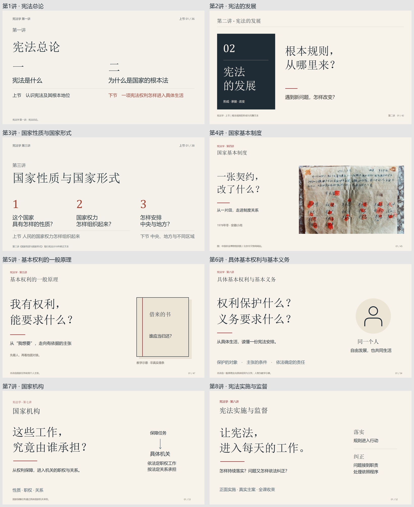

# 八讲课堂PPT｜当前交付入口

2026年10月16日，按教师明确要求上传。当前采用2026年10月15日授课净稿，八讲共367页，完整口播在逐页备注中，保留简单手动点击动效。

**[下载八讲整包](宪法学八讲_授课净稿_20261015.zip)**｜[分讲文件目录](宪法学八讲_授课净稿_20261015/)｜[版本清单](宪法学八讲_授课净稿_20261015/版本清单.json)｜[核对与使用说明](宪法学八讲_授课净稿_20261015/检查与使用说明.md)

此版替代此前本地“全课核对版”，清理了投影中的制作说明，并复查修改后的显示与点击时机；原有主图、布局、口播备注及简单动效保留。图片补充由教师自行处理，本轮不嵌入表决票图片。此处文件及整包与已交付本地净稿逐字节相同，不混入旧课件、DS在制文件或其他导出。第一、三讲仍保留此前明确基线和局部修订历史，不冒称整份从零制作。

对应总纲、分纲及八份当前口播的课程提交为`a3a47a22e03b2a190a91fab901bf59f765309b40`，各稿SHA见版本清单。本次不修改课程正文、分纲或独立PPT技能仓；既有历史课件按原用途保留，后续使用先从本入口选取，不按文件名猜最新。口播稿原有教师待审身份不因上传改变。

整包SHA256：`b1a6294ef0ed4e36dc9e8c40ac305a08c034cb2f2e153a7a4b6ccd9935c0b77f`。

| 讲次 | 课件 | 页数 | SHA256 |
| --- | --- | ---: | --- |
| 1 | [宪法总论](宪法学八讲_授课净稿_20261015/01_第一讲_宪法总论.pptx) | 36 | aa2027c11f0c2804ce4202179a12e1c9905d8ac34aa743f9df23382f916d40cf |
| 2 | [宪法的发展](宪法学八讲_授课净稿_20261015/02_第二讲_宪法的发展.pptx) | 42 | 54b962cdc006e02ece3b81e84ece840be05a691e30b78999d412812b3764976c |
| 3 | [国家性质与国家形式](宪法学八讲_授课净稿_20261015/03_第三讲_国家性质与国家形式.pptx) | 38 | 43335e0a7b21ae7609627795c72749d7d536691a0a779d2404b820e9c94f90c9 |
| 4 | [国家基本制度](宪法学八讲_授课净稿_20261015/04_第四讲_国家基本制度.pptx) | 45 | 721fce04f6dd2f02f1780491ee9efcfd8b8c361a0417ee7b18f019eadaf1935e |
| 5 | [基本权利的一般原理](宪法学八讲_授课净稿_20261015/05_第五讲_基本权利的一般原理.pptx) | 47 | 914ee7e39c7dcb65b5b7cb80798cc031538db539fccf126522104c65ca546e18 |
| 6 | [具体基本权利与基本义务](宪法学八讲_授课净稿_20261015/06_第六讲_具体基本权利与基本义务.pptx) | 54 | c525dd8639313b5a6f63265f4256bceca11aaad7e1b0769e7038abe40a3b7450 |
| 7 | [国家机构](宪法学八讲_授课净稿_20261015/07_第七讲_国家机构.pptx) | 53 | ad2a497f58374ce03e2f6430eb0aa0b3d0a1b100ed43fa09054b7eeacfa63595 |
| 8 | [宪法实施与监督](宪法学八讲_授课净稿_20261015/08_第八讲_宪法实施与监督.pptx) | 52 | e7f4f68133d7f4213f668a8f0cfd05f20f72b8b3f210eb7d97d35bec3c98afe1 |

检查范围：实际WPS成品与静态点击状态、完整备注及来源绑定；变更146页329有效态有本轮实际整图观看记录，其余221页478态按图片、完整页卡、来源段和备注等值承接真实既有布局观察，旧制作话语接受判断已撤销。未实测现场动态播放、教室后排或课堂效果，不移记教师认可。
